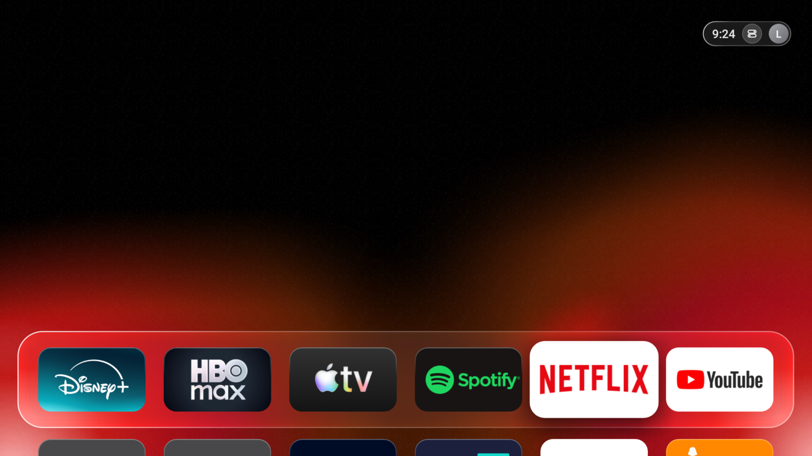
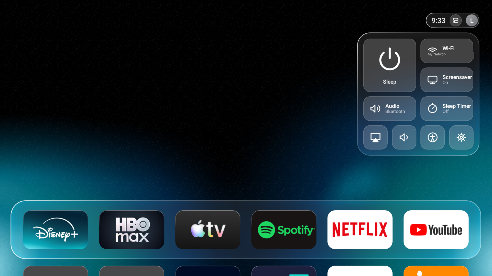
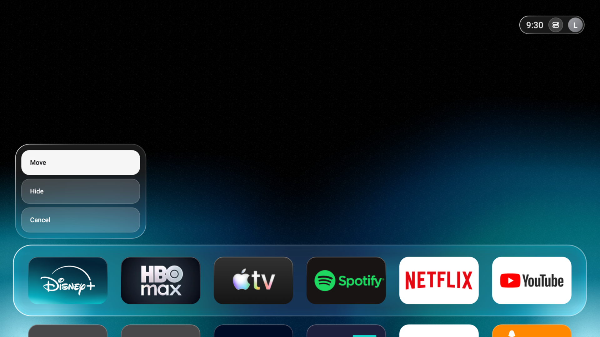

# Glass Home

A tvOS-style home screen for the Fire TV Stick. No root, fully reversible, no Apple-owned assets (no
Apple logo, no SF Pro, no Apple sounds or wallpapers) — just the layout, the glass, and the motion.

Created by [Levente Botos](https://github.com/LeventeBotos).



## What this is

Glass Home replaces the Fire TV's own launcher with one that looks and feels like Apple TV's "Glass"
home screen: a dock of 5:3 app icons that lift and glow on focus, a status pill with the clock and a
Control Center button, and an animated, colour-reactive gradient background behind everything.

It does this **without root** and **without replacing anything permanently**. It's a second app that
watches for the Home button (via a log-reading permission ADB can grant, no accessibility service
needed — Fire OS silently drops those) and opens itself instead of Amazon's launcher. Nothing is
uninstalled, nothing is disabled. One command puts it all back.

## Screenshots

| Home | Control Center | Long-press menu |
|---|---|---|
|  |  |  |

## Features

- **A real dock**, not a grid — icons scale up and cast a soft shadow on focus, exactly like tvOS
- **An animated backdrop**: two irregular, slow-drifting colour splatters anchored to the bottom
  corners, recoloured live from the **dominant colour of whichever app is focused**, with a faint film
  grain over the top
- **Control Center** (the status pill, top right): Sleep, Wi-Fi, Screensaver on/off, Audio output,
  Sleep Timer, AirPlay/casting, volume, accessibility and a brightness-style placeholder — opened with
  a click or the remote's Menu button
- **Move and hide apps**: long-press (or Menu) an icon for Move / Hide, just like tvOS's App Store page
- **A screensaver** using the same animated gradient, or free aerial nature footage (Pexels, optional,
  fetched once and cached) — no Apple Aerial content
- **Click/focus sounds**, a system font (no bundled typefaces), and a layout measured from a real
  tvOS 26 screenshot
- **Fully reversible**: one `--remove` command uninstalls the app and restores every setting Glass Home
  touched, recorded *before* the first change was made

## Requirements

- A Fire TV Stick. Built and tested on a **Fire TV Stick 4K (2018), Fire OS 6.7 / Android 7.1.2**; it
  should work on other Fire OS 5–7 sticks too (the APK targets Android 5.1+), but hasn't been verified
  on all of them.
- A computer on the **same Wi-Fi network** as the stick, with:
  - **Python 3.9+**
  - **Android SDK build-tools and a platform** (to compile the APK — no Gradle, no Android Studio
    project needed, just the command-line tools). The easiest way to get these:
    1. Install [Android Studio](https://developer.android.com/studio) once, or just the
       [command-line tools](https://developer.android.com/studio#command-tools)
    2. Open SDK Manager (or run `sdkmanager`) and install any one **"Android SDK Platform"** and the
       **"Android SDK Build-Tools"**
    3. Make sure `$ANDROID_HOME` (or `$ANDROID_SDK_ROOT`) points at the SDK folder, or that it's
       installed in the default location the scripts already look for

## Set it up with an AI assistant

Everything below is also written as a prompt, so a terminal-capable AI coding assistant (Claude Code,
OpenAI Codex CLI, ChatGPT with its desktop/agent mode, etc.) can do the install for you — cloning the
repo, installing the Android build tools if needed, pairing with the stick and running the install
script. Open a terminal in an empty folder, start your assistant there, and paste this:

```
Set up https://github.com/LeventeBotos/firetv-glass-home on my Fire TV Stick.

1. Read the repository's README.md in full before doing anything else.
2. Ask me for my Fire TV Stick's IP address if I haven't given it to you, and confirm I've turned on
   ADB Debugging under Settings → My Fire TV → Developer Options (tell me how to reveal that menu if
   it's hidden, and to also enable "Apps from Unknown Sources").
3. Clone the repo, then follow the README's "Installing it" steps exactly: set up the tools/venv
   Python environment, check whether I already have Android SDK build-tools and a platform installed
   (ANDROID_HOME/ANDROID_SDK_ROOT), and help me install them if not.
4. Ask whether I want the screensaver's free aerial nature footage (the default) or just the plain
   animated gradient (set `NO_AERIALS=1` if I say the gradient).
5. Run glasshome/install.sh with TV_HOST set to my stick's IP. The very first run needs me to accept
   an "Allow USB/ADB debugging" prompt on the TV itself — tell me to go look at the TV, then re-run
   the install once I've accepted it.
6. Ask whether I also want AirPlay set up, and if so run glasshome/airplay/setup.py per the README's
   "AirPlay (optional)" section, explaining that it disables (not uninstalls) the stick's built-in
   AirPlay receiver so the two don't fight over the same port.
7. Remind me to turn off Fire OS's own Navigation Sounds (Settings → Accessibility → Navigation
   Sounds) so they don't clash with Glass Home's own sounds, exactly as the README says.
8. Confirm the install finished and tell me to press Home on the remote.
9. Tell me the commands to fully uninstall Glass Home and, separately, AirPlay if I installed it,
   restoring my Fire TV to how it was before either one, and remind me it's safe to walk away from
   at any point — nothing is changed on the stick until a script actually runs.

Ask me before running anything that isn't one of the documented commands in the README.
```

Or follow the same steps yourself, by hand:

## Installing it

1. **Turn on ADB debugging on the stick.** Settings → My Fire TV (or Device) → Developer Options
   (if it's hidden, open Settings → My Fire TV → About and click the device name/build 7 times to
   reveal it) → turn on **ADB Debugging**. Also turn on **Apps from Unknown Sources** if it's off.
2. **Find the stick's IP address.** Settings → My Fire TV → About → Network.
3. **Clone this repository** on your computer:
   ```bash
   git clone https://github.com/LeventeBotos/firetv-glass-home.git
   cd firetv-glass-home
   ```
4. **Set up the Python side:**
   ```bash
   python3 -m venv tools/venv
   tools/venv/bin/pip install -r tools/requirements.txt
   ```
5. **Install Glass Home**, with `TV_HOST` set to the stick's IP from step 2:
   ```bash
   TV_HOST=192.168.1.50 glasshome/install.sh
   ```
   The first time, a prompt appears **on the TV** asking to allow ADB debugging from this computer —
   confirm it there, then re-run the command. This step also downloads a few seconds of free aerial
   footage for the screensaver; skip that with `NO_AERIALS=1 TV_HOST=... glasshome/install.sh` if you'd
   rather just use the animated gradient.
6. **Turn off Fire OS's own navigation sounds**, so they don't play on top of Glass Home's own
   focus/select sounds: Settings → Accessibility → Navigation Sounds → Off (the exact path varies a
   little by Fire OS version — look for "Navigation Sounds" or "Sound Effects" under Accessibility or
   Display & Sounds).
7. Press **Home** on the remote. That's it.

## Using it

- **Focus** an icon with the D-pad; it lifts and the background recolours to match it.
- **Click the status pill** (top right) or press **Menu** to open **Control Center**.
- **Long-press an icon**, or focus it and press **Menu**, for **Move** (pick it up, D-pad it to a new
  spot, press Select/OK to drop it) or **Hide**.
- The **screensaver** starts after the normal Fire TV idle timeout, and can be toggled from Control
  Center.

## The screensaver: aerial footage or the gradient alone

Glass Home comes with its own screensaver (`settings put secure screensaver_components` is pointed at
it during install, and put back to Amazon's own on `--remove`). It has two looks:

- **Aerial nature clips** — a handful of free Pexels videos (coastal cliffs, desert dunes, an alpine
  valley, a waterfall, a turquoise cove; see `glasshome/aerials/CREDITS.md` and `clips.txt`), downloaded
  once to `~/.cleanyourtv/aerials/` on your computer and sent to the stick over the local network during
  install. This is the default.
- **The animated gradient alone** (the same backdrop as the home screen) — used automatically if you
  install with `NO_AERIALS=1`, or if the aerial download/transfer is skipped for any reason.

To **switch an already-installed stick** from aerials back to the plain gradient, clear the clips it
was sent:
```bash
TV_HOST=192.168.1.50 tools/venv/bin/python -I glasshome/aerials/push.py --clear
```
To go the other way (add the aerials after installing with `NO_AERIALS=1`), just re-run
`TV_HOST=... glasshome/install.sh` without that flag.

Want your own footage instead? Drop 16:9 H.264 `.mp4` files into `~/.cleanyourtv/aerials/` yourself
(see the comment at the top of `glasshome/aerials/clips.txt`) and run `aerials/push.py` to send them.

## AirPlay (optional)

Control Center's casting tile works once an AirPlay receiver is installed — Glass Home doesn't bundle
one (it isn't Glass Home's own code, and it's a 27 MB download), but it can set one up for you:

```bash
TV_HOST=192.168.1.50 glasshome/airplay/setup.py
```

This downloads a specific, checksum-pinned release of [android-airplay-server](https://github.com/jqssun/android-airplay-server)
(GPL-3.0, by jqssun, built on UxPlay) and installs it. Fire TV's own built-in AirPlay receiver
("AirReceiver") is **disabled, not uninstalled** first, since two receivers can't share the AirPlay
port — whether it was already on is recorded, so removing the new one puts it back exactly as it was:
```bash
TV_HOST=192.168.1.50 glasshome/airplay/setup.py --remove
```
Once installed, open it from your iPhone/Mac's AirPlay picker like any other AirPlay receiver, or tap
the casting icon in Control Center to bring it to the front.

## Uninstalling

```bash
TV_HOST=192.168.1.50 glasshome/install.sh --remove
```

This uninstalls the app and restores the screensaver settings and permission to exactly what they
were before Glass Home was ever installed (the very first install run records that state, so this
works even after many re-installs). Amazon's own launcher and screensaver come back on the next
Home press.

## How it works, briefly

- **Taking over Home**: Fire OS always sends the Home button to `com.amazon.tv.launcher`, whatever else
  is installed, and it silently drops any accessibility service ADB tries to enable. It does let ADB
  grant `READ_LOGS`, though, and every Home press is logged by ActivityManager. `HomeWatcher` (a
  service, started at boot and by the app itself) follows that log and brings Glass Home's own
  `HomeActivity` to the front right after, so the Home press is effectively redirected.
- **Everything else** (the dock, Control Center, the context menu, the animated backdrop) is a normal
  Android app, built with `javac` + `d8` and signed with a debug key — no Gradle involved. See
  `glasshome/build.sh`.
- **The backdrop** (`GradientBackdrop.java`) samples the focused app icon's own pixels for a dominant
  colour, then paints two hand-built, randomly-shaped "splatter" blobs (not circles) with `BlurMaskFilter`
  for soft organic edges, plus a tileable stipple-noise overlay — all rendered at a tiny internal
  resolution and scaled up, which is what keeps it smooth on a Fire TV Stick's hardware.

## Known limits

- This **replaces the Home button and launcher UI only**. It cannot act as an HDMI-CEC or Bluetooth
  remote target, inject D-pad/navigation events into *other* apps, or otherwise act like a jailbroken
  stick — none of that is possible without root on stock Fire OS.
- The animated backdrop and app tiles are drawn at a small internal resolution and scaled up for
  performance; this is intentional and matches how the real tvOS wallpaper engine is similarly cheap.
- Built and verified against one specific device/Fire OS version (see Requirements). Other Fire TV
  models may need small tweaks — PRs welcome.

## Credits

- The screensaver's aerial footage (optional) is free stock video from
  [Pexels](https://www.pexels.com), used under the [Pexels License](https://www.pexels.com/license/).
  See `glasshome/aerials/CREDITS.md`. Apple's own Aerial videos are **not** used anywhere.
- The optional AirPlay receiver is [android-airplay-server](https://github.com/jqssun/android-airplay-server)
  by jqssun (GPL-3.0, built on UxPlay) — `glasshome/airplay/setup.py` downloads and verifies it against a
  pinned checksum; it is not bundled in this repository.
- No Apple software, fonts, sounds or imagery are included or downloaded. The look is a clean-room
  re-implementation from measurements of a real tvOS 26 screenshot, using the system font and
  originally made click/focus sounds.

## License

MIT — see [LICENSE](LICENSE). Third-party assets referenced above keep their own licenses.

PSA: please fork and upgrade this repo.